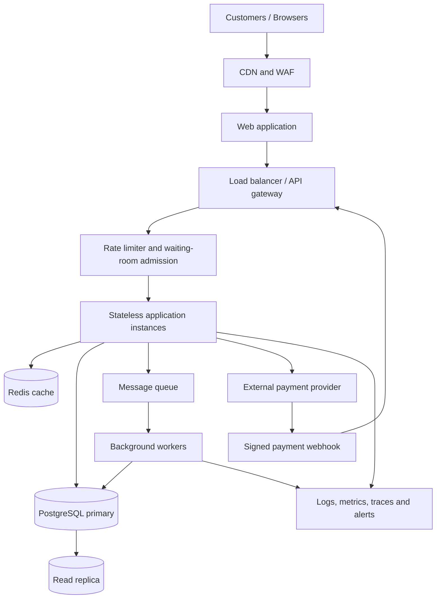

# TicketHub — Event Ticketing System Design

**Course:** Software Engineering — Day 8 Capstone  
**Repository location:** `day8/ticketing-design.md`  
**Status:** Proposed design  
**Version:** 1.0

---

## 1. Context and scope

TicketHub is a website for discovering concerts and events, selecting seats, reserving them temporarily, paying for orders, and viewing purchased tickets. The most important correctness requirement is that one physical seat must never be sold to two customers.

This document applies the course's six-part system-design framework: requirements, estimates, API, data model, architecture, and trade-offs. It uses the workload figures supplied in the assignment. Where the assignment does not provide a value (for example, a latency target or sale burst multiplier), the value is explicitly labelled as a design assumption rather than a given fact.

### Goals

- Let customers browse events and inspect seat availability.
- Let authenticated customers hold available seats temporarily and complete payment.
- Issue tickets only after a successful, verified payment.
- Prevent duplicate active holds and duplicate confirmed tickets for a seat.
- Remain responsive during the stated high-demand sale.

### Non-goals for this version

- Resale and ticket transfers between customers.
- Dynamic pricing, seat auctions, and loyalty programmes.
- Multiple currencies and complex tax jurisdictions.
- Offline ticket validation.
- Building a payment processor; TicketHub integrates with an external provider.

## 2. Requirements

### 2.1 Functional requirements

1. Customers can register, sign in, and manage their account.
2. Customers can browse, search, and view published events.
3. Customers can view an event's seating plan and current seat availability.
4. An authenticated customer can request a temporary hold on one or more available seats.
5. A hold expires automatically after a defined checkout window (proposed default: 8 minutes).
6. A customer can create an order for the seats they hold and initiate payment.
7. The system verifies payment-provider callbacks before marking an order paid.
8. The system issues a unique ticket for each confirmed seat.
9. Customers can view their orders and tickets.
10. Customers receive a clear response when a seat is already held, sold, or no longer available.
11. Administrators can create events, configure venues/seats, publish events, and inspect orders (administrative endpoints are outside the minimum customer API below).

### 2.2 Non-functional requirements

| Attribute | Requirement / proposed target | Reason |
|---|---|---|
| Correctness | A seat has at most one active hold and at most one confirmed ticket for an event. | Prevent financial loss and customer disputes. |
| Availability | Browsing should remain available during a sale; checkout may reject or queue excess demand rather than oversell. | Graceful degradation is better than incorrect sales. |
| Performance | Proposed target: p95 event/seat reads under 300 ms under planned load; hold requests under 500 ms, excluding external payment time. | Responsive customer experience. These are design targets, not assignment-provided facts. |
| Scalability | Scale stateless application instances horizontally and control entry to checkout during the major sale. | Handle sudden demand. |
| Fairness | Use a virtual waiting room with a transparent queue policy and short-lived admission tokens. | Avoid letting repeated refreshes or scripts bypass the line. |
| Security | TLS, hashed passwords, authorization checks, rate limits, signed payment webhooks, and no storage of card details. | Protect accounts and payments. |
| Reliability | Idempotent order/payment operations, retries with limits, backups, and monitoring. | Avoid duplicate charges/orders and support recovery. |
| Consistency | Seat allocation and order confirmation use transactional database writes. Cache data is never authoritative for a purchase. | A stale cache must not sell an unavailable seat. |

**Fairness policy assumption:** customers enter a waiting room before the sale opens. The system assigns a queue position using a documented policy (for example, randomized positions for customers present at the announced opening time, followed by FIFO). Each admitted customer receives a short-lived signed token. The assignment does not prescribe a queue policy; this is a proposed policy that should be published before sales.

## 3. Estimates and workload

### 3.1 Normal day

Given:
- 50,000 visitors per normal day.
- Each visitor views 10 pages.
- 5,000 tickets sold per normal day.
- 86,400 seconds in a day.

Calculations:

- Page views per day = 50,000 × 10 = **500,000 page views/day**.
- Average page views per second = 500,000 ÷ 86,400 = **5.79 page views/second**, approximately **6/s**.
- Tickets sold per day = **5,000** (given).
- The assignment does not state the exact number of API requests per page, read/write mix, or peak-to-average ratio. Therefore, 5.79 is a page-view average, not a complete API request-rate estimate.

### 3.2 Popular concert sale

Given:
- 200,000 people try to buy tickets within the first 10 minutes.
- 20,000 seats are available.
- 10 minutes = 600 seconds.

Calculations:

- Average arrival rate over the window = 200,000 ÷ 600 = **333.33 people/second**, approximately **333/s**.
- Demand-to-capacity ratio = 200,000 ÷ 20,000 = **10 people per seat**.
- Only 20,000 of the 200,000 people can obtain seats if every seat is sold once. At most **10%** of the interested people can be successful.
- The 333/s figure is an average across ten minutes. Real traffic may arrive in a much sharper burst at the opening second, so capacity tests must include burst scenarios above this average.

### 3.3 Comparison and implications

Normal browsing averages about 6 page views per second. During the popular sale, about 333 people per second attempt to buy, before counting their additional page views, polling, seat selection, and payment-related requests. The sale's average arrival rate is therefore much more demanding than normal browsing, and it is concentrated on a limited set of seats.

The design must protect the database from a sudden wave of requests. A waiting room controls how many customers reach the seat-hold service at once. Caching helps with event descriptions and seating-plan reads, but only the relational database can make the final authoritative decision to allocate a seat.

**Capacity-planning note:** do not claim that 333/s is the maximum system load. Load tests should ramp above the calculated average and simulate a synchronized opening burst. The precise multiplier must be chosen from test results and operational capacity.

## 4. API design

Base path: `/api/v1`  
Format: JSON over HTTPS.  
Authentication: bearer access token for customer-specific endpoints.  
All IDs are opaque identifiers (UUIDs in this design).

### 4.1 Browse published events

`GET /api/v1/events?query= jazz&date=2026-11-20&page=1&pageSize=20`

- Purpose: list published events with pagination and optional filters.
- Success: `200 OK`.
- Example response:

```json
{
  "items": [
    {
      "id": "evt_01",
      "name": "Kampala Live",
      "startsAt": "2026-11-20T18:00:00+03:00",
      "venueName": "City Arena"
    }
  ],
  "page": 1,
  "pageSize": 20,
  "total": 1
}
```

### 4.2 View event details and seating availability

`GET /api/v1/events/{eventId}/seats`

- Purpose: return the event's seat map and a best-effort availability snapshot.
- Success: `200 OK`.
- The response may be cached briefly. It is informational only; a seat shown as available is not guaranteed until a hold succeeds.
- Example response:

```json
{
  "eventId": "evt_01",
  "seats": [
    {"seatId": "seat_A12", "section": "A", "row": "1", "number": "12", "status": "AVAILABLE"},
    {"seatId": "seat_A13", "section": "A", "row": "1", "number": "13", "status": "HELD"}
  ]
}
```

### 4.3 Hold seats

`POST /api/v1/events/{eventId}/holds`

- Authentication: required.
- Header: `Idempotency-Key: <unique-client-generated-key>`.
- Purpose: atomically hold one or more seats for the authenticated customer.
- Success: `201 Created`.
- Possible errors: `409 Conflict` if any requested seat is unavailable; `401 Unauthorized`; `422 Unprocessable Content` for invalid seat IDs; `429 Too Many Requests` if rate limited.
- Example request:

```json
{
  "seatIds": ["seat_A12", "seat_A13"]
}
```

- Example response:

```json
{
  "holdId": "hold_01",
  "eventId": "evt_01",
  "seatIds": ["seat_A12", "seat_A13"],
  "expiresAt": "2026-11-20T17:08:00+03:00",
  "status": "ACTIVE"
}
```

The operation succeeds for all requested seats or none of them. The server derives `userId` from the authenticated token; it must not trust a user ID supplied in the request body.

### 4.4 Create an order from a hold

`POST /api/v1/orders`

- Authentication: required.
- Header: `Idempotency-Key: <unique-client-generated-key>`.
- Purpose: create a pending order for a valid hold owned by the customer.
- Success: `201 Created`.
- Possible errors: `409 Conflict` for an expired/invalid hold; `404 Not Found` for an unknown hold.
- Example request:

```json
{
  "holdId": "hold_01"
}
```

- Example response:

```json
{
  "orderId": "ord_01",
  "status": "PENDING_PAYMENT",
  "amount": 200000,
  "currency": "UGX"
}
```

The server calculates prices from trusted event/seat pricing records, not from a client-submitted amount.

### 4.5 Initiate payment

`POST /api/v1/orders/{orderId}/payment`

- Authentication: required; the order must belong to the customer.
- Header: `Idempotency-Key: <unique-client-generated-key>`.
- Purpose: create or retrieve a payment attempt with the configured payment provider.
- Success: `202 Accepted` because payment is asynchronous.
- Possible errors: `409 Conflict` if the order is not payable; `502 Bad Gateway` if the provider is unavailable.
- Example response:

```json
{
  "orderId": "ord_01",
  "paymentStatus": "PROCESSING",
  "paymentReference": "pay_ref_01",
  "checkoutUrl": "https://payment-provider.example/checkout/..."
}
```

TicketHub does not treat a browser redirect or client-side success message as proof of payment. It verifies a signed provider webhook (and, where necessary, queries the provider).

### 4.6 Payment-provider webhook

`POST /api/v1/webhooks/payments/{provider}`

- Authentication: provider signature verification; not a customer bearer-token endpoint.
- Purpose: receive payment status updates.
- Success: `200 OK` after the event is safely recorded/queued.
- The handler verifies the signature, checks the provider transaction reference, and processes each provider event idempotently. Duplicate webhook delivery must not issue duplicate tickets.

### 4.7 View my tickets

`GET /api/v1/me/tickets?page=1&pageSize=20`

- Authentication: required.
- Purpose: list tickets belonging to the authenticated customer.
- Success: `200 OK`.
- Possible errors: `401 Unauthorized`.
- Example response:

```json
{
  "items": [
    {
      "ticketId": "tkt_01",
      "eventId": "evt_01",
      "eventName": "Kampala Live",
      "seatLabel": "A-1-12",
      "status": "VALID"
    }
  ],
  "page": 1,
  "pageSize": 20
}
```

### 4.8 API-wide rules

- Use `400` for malformed requests, `401` for unauthenticated requests, `403` for forbidden actions, `404` for missing resources, `409` for state conflicts, `422` for semantically invalid input, and `429` for rate limits.
- Paginate list endpoints and cap `pageSize`.
- Validate all input on the server.
- Use idempotency keys for operations that create holds, orders, and payment attempts.
- Never expose another customer's holds, orders, or tickets.
- Return stable machine-readable error codes with safe human-readable messages.

## 5. Data model

Use PostgreSQL as the authoritative relational database. The following model contains six core tables, exceeding the required minimum of four.

### 5.1 Tables and relationships

#### `users`

| Column | Type | Constraint / purpose |
|---|---|---|
| `id` | UUID | Primary key |
| `email` | VARCHAR(255) | NOT NULL, UNIQUE |
| `password_hash` | TEXT | NOT NULL; never store plaintext passwords |
| `created_at` | TIMESTAMPTZ | NOT NULL, default current timestamp |

#### `events`

| Column | Type | Constraint / purpose |
|---|---|---|
| `id` | UUID | Primary key |
| `name` | VARCHAR(200) | NOT NULL |
| `description` | TEXT | Optional |
| `venue_name` | VARCHAR(200) | NOT NULL |
| `starts_at` | TIMESTAMPTZ | NOT NULL |
| `status` | VARCHAR(20) | NOT NULL; e.g. DRAFT, PUBLISHED, CANCELLED |
| `created_at` | TIMESTAMPTZ | NOT NULL, default current timestamp |

#### `seats`

A seat row represents a physical seat for a particular event. This makes seat allocation event-specific.

| Column | Type | Constraint / purpose |
|---|---|---|
| `id` | UUID | Primary key |
| `event_id` | UUID | NOT NULL, FK → `events.id` |
| `section` | VARCHAR(50) | NOT NULL |
| `row_label` | VARCHAR(20) | NOT NULL |
| `seat_number` | VARCHAR(20) | NOT NULL |
| `price_minor` | BIGINT | NOT NULL, non-negative; amount in the currency's minor unit |
| `currency` | CHAR(3) | NOT NULL, e.g. UGX |
| `created_at` | TIMESTAMPTZ | NOT NULL, default current timestamp |

Constraint: `UNIQUE(event_id, section, row_label, seat_number)` prevents duplicate physical seat definitions within an event.

#### `holds`

One row per seat in a hold. A multi-seat request creates several rows sharing one `hold_group_id`.

| Column | Type | Constraint / purpose |
|---|---|---|
| `id` | UUID | Primary key |
| `hold_group_id` | UUID | NOT NULL; groups seats held in one request |
| `seat_id` | UUID | NOT NULL, FK → `seats.id` |
| `user_id` | UUID | NOT NULL, FK → `users.id` |
| `expires_at` | TIMESTAMPTZ | NOT NULL |
| `status` | VARCHAR(20) | NOT NULL; ACTIVE, CONVERTED, EXPIRED, RELEASED |
| `created_at` | TIMESTAMPTZ | NOT NULL, default current timestamp |

Use a partial unique index to ensure a seat cannot have two active holds:

```sql
CREATE UNIQUE INDEX one_active_hold_per_seat
ON holds (seat_id)
WHERE status = 'ACTIVE';
```

Expired holds must be changed from ACTIVE to EXPIRED by a background worker. The hold endpoint must also check expiry within its transaction; it must not assume that the cleanup worker has already run.

#### `orders`

| Column | Type | Constraint / purpose |
|---|---|---|
| `id` | UUID | Primary key |
| `user_id` | UUID | NOT NULL, FK → `users.id` |
| `hold_group_id` | UUID | NOT NULL; references the hold group logically |
| `total_minor` | BIGINT | NOT NULL, non-negative |
| `currency` | CHAR(3) | NOT NULL |
| `status` | VARCHAR(30) | NOT NULL; PENDING_PAYMENT, PAID, FAILED, EXPIRED, REFUNDED |
| `created_at` | TIMESTAMPTZ | NOT NULL, default current timestamp |

#### `order_items`

One row per seat in an order.

| Column | Type | Constraint / purpose |
|---|---|---|
| `id` | UUID | Primary key |
| `order_id` | UUID | NOT NULL, FK → `orders.id` |
| `seat_id` | UUID | NOT NULL, FK → `seats.id` |
| `unit_price_minor` | BIGINT | NOT NULL, non-negative; snapshot of price at purchase |
| `currency` | CHAR(3) | NOT NULL |

Constraint: `UNIQUE(order_id, seat_id)` prevents the same seat being added twice to one order.

#### `payments`

| Column | Type | Constraint / purpose |
|---|---|---|
| `id` | UUID | Primary key |
| `order_id` | UUID | NOT NULL, FK → `orders.id` |
| `provider_reference` | VARCHAR(150) | NOT NULL, UNIQUE |
| `idempotency_key` | VARCHAR(150) | NOT NULL, UNIQUE |
| `amount_minor` | BIGINT | NOT NULL, non-negative |
| `currency` | CHAR(3) | NOT NULL |
| `status` | VARCHAR(20) | NOT NULL; INITIATED, PROCESSING, SUCCEEDED, FAILED |
| `created_at` | TIMESTAMPTZ | NOT NULL, default current timestamp |

#### `tickets`

| Column | Type | Constraint / purpose |
|---|---|---|
| `id` | UUID | Primary key |
| `order_item_id` | UUID | NOT NULL, UNIQUE, FK → `order_items.id` |
| `seat_id` | UUID | NOT NULL, FK → `seats.id` |
| `ticket_code` | VARCHAR(100) | NOT NULL, UNIQUE; unguessable/random |
| `status` | VARCHAR(20) | NOT NULL; VALID, USED, CANCELLED |
| `issued_at` | TIMESTAMPTZ | NOT NULL, default current timestamp |

A confirmed ticket must also be protected by a database-level uniqueness rule on `seat_id` (or by a separate `confirmed_seat_allocations` table with `seat_id` as its primary key). This is the final defence against two orders receiving the same seat. If tickets can be reissued after cancellation, the allocation lifecycle must be modelled explicitly rather than deleting the uniqueness protection.

### 5.2 Relationship summary

- One `user` can create many `holds` and many `orders`.
- One `event` has many `seats`.
- One `seat` can have historical hold records, but at most one ACTIVE hold at a time.
- One `order` contains many `order_items`.
- One `order` can have payment attempts recorded in `payments`.
- One `order_item` produces at most one `ticket`.
- A `ticket` refers to one seat, and a seat can have at most one confirmed valid allocation.

### 5.3 Simplified SQL for the critical constraints

```sql
-- One active hold per seat.
CREATE UNIQUE INDEX one_active_hold_per_seat
ON holds (seat_id)
WHERE status = 'ACTIVE';

-- No duplicate seat line within one order.
ALTER TABLE order_items
ADD CONSTRAINT unique_seat_per_order UNIQUE (order_id, seat_id);

-- At most one ticket record per order item.
ALTER TABLE tickets
ADD CONSTRAINT one_ticket_per_order_item UNIQUE (order_item_id);

-- At most one confirmed ticket allocation per seat.
CREATE UNIQUE INDEX one_ticket_per_seat
ON tickets (seat_id)
WHERE status IN ('VALID', 'USED');
```

The partial indexes above assume PostgreSQL. A production implementation must coordinate ticket cancellation/reissue with the allocation transaction so that a cancelled ticket releases the seat only when the business rules permit it.

### 5.4 How double-booking is prevented

A simple `SELECT` that checks whether a seat is available, followed later by an `INSERT`, is unsafe. Two requests can both read AVAILABLE before either writes. This is a race condition.

TicketHub uses several layers of protection:

1. **Database transaction:** the hold operation runs in a transaction. It locks the requested seat rows in a consistent order (`SELECT ... FOR UPDATE`) to serialize competing attempts for the same seat.
2. **Expiry check:** within the transaction, the server treats a hold as active only when `expires_at > now()`. An expired active row is changed to EXPIRED before a new hold is inserted.
3. **Unique constraint:** the partial unique index on `holds(seat_id)` for ACTIVE rows is enforced by PostgreSQL. Even if application code has a bug or two requests race, the database rejects a second active hold.
4. **All-or-nothing multi-seat holds:** if a customer requests several seats and any one cannot be held, the transaction rolls back so the customer does not receive a partial selection unexpectedly.
5. **Payment confirmation:** after a verified successful payment, a transaction locks and validates the order/hold, records the payment result idempotently, converts the hold, and creates the ticket/allocation records. The unique seat constraint is the final safeguard.
6. **Idempotency:** repeated client requests or duplicate payment webhooks return the existing result instead of creating another order or ticket.

Do not keep a database transaction open while a customer interacts with a payment provider. The hold has a fixed expiry; payment is asynchronous. If payment succeeds after the hold expires, the system must re-check allocation. If the seat has already been allocated, it must not issue a duplicate ticket; it should initiate a refund/manual exception workflow.

**Important implementation detail:** PostgreSQL partial unique indexes cannot use a changing time predicate such as `WHERE expires_at > now()`. Therefore, the index is based on `status = 'ACTIVE'`, and expired rows are transitioned to `EXPIRED` by a worker and by the hold transaction itself. This avoids relying on an invalid time-dependent index.

## 6. High-level architecture

### 6.1 Architecture diagram



### 6.2 Component responsibilities and justification

| Component | Responsibility | Why it is included |
|---|---|---|
| CDN | Delivers static assets and cacheable public content close to users. | Reduces load and improves page delivery. |
| WAF | Filters common malicious web traffic. | Protects public endpoints. |
| Web application | Displays events, seat maps, checkout and tickets. | Customer interface. |
| Load balancer/API gateway | Routes requests across healthy application instances and centralizes API policies. | Avoids dependence on one application server. |
| Rate limiter and waiting room | Limits admission to expensive sale/hold operations and applies the published queue policy. | Protects the database during the major sale and supports fairness. |
| Stateless app instances | Validate requests, enforce authorization, and execute business logic. | Can scale horizontally; any instance can handle the next request. |
| Redis | Caches public event details and short-lived read data; may hold queue/session metadata. | Reduces repeated reads. It is not the final authority for seat ownership. |
| PostgreSQL primary | Stores users, events, seats, holds, orders, payments and tickets; enforces transactions and constraints. | Strong transactional consistency is essential for seat allocation. |
| Read replica | Serves suitable read-only queries such as event browsing and reporting. | Moves non-critical read load away from the primary. Seat availability shown from a replica may be slightly stale and must be revalidated on hold. |
| Message queue and workers | Process payment events, hold expiry, ticket notifications and other retryable background work. | Keeps slow work out of the customer's request and supports retries. |
| Payment provider | Processes card/mobile-money payments. | TicketHub should not store card details. |
| Observability | Collects logs, metrics, traces and alerts. | Detects slowdowns, errors, queue buildup and database contention. |

### 6.3 Request flow for a seat purchase

1. A customer loads the event page. The CDN serves static files; the API reads public event information from cache where possible.
2. When the sale opens, the customer enters the waiting room. The admission service issues a short-lived token according to the published queue policy.
3. The customer requests a seat hold. The application validates the token and user, then starts a PostgreSQL transaction.
4. The transaction locks the seat rows, checks their current state and expiry, inserts ACTIVE hold rows, and commits. The database unique index rejects any competing active hold.
5. The customer creates an order and starts payment. The application sends the payment request to the provider using an idempotency key, then returns a pending status.
6. The provider sends a signed webhook. TicketHub verifies it and processes it idempotently through a worker/transaction.
7. If payment is confirmed and the hold remains valid, the system records the paid order and creates ticket allocations atomically. The customer can retrieve the tickets.
8. If the hold expires without successful payment, a worker marks it EXPIRED and makes the seat eligible for another hold.

### 6.4 How the design survives the major sale

- The CDN absorbs static content delivery and reduces repeated origin requests.
- The waiting room controls the rate at which purchase traffic reaches the application and database.
- Rate limits and short-lived admission tokens discourage refresh storms and automated abuse.
- Stateless application instances scale horizontally behind the load balancer.
- Redis handles cacheable event and venue reads, but seat claims always go to PostgreSQL.
- The primary database is protected from uncontrolled concurrent writes; transactions and unique constraints preserve correctness.
- Read replicas serve suitable browsing/reporting reads, never the final decision to allocate a seat.
- Queues and background workers handle payment webhooks, expiry, and notifications with retries.
- Monitoring tracks queue length, request rate, p95/p99 latency, error rate, database connections, lock waits, payment failures, and hold-to-purchase conversion.

## 7. Trade-offs and alternatives

### Trade-off 1: Strongly consistent database writes vs maximum throughput

**Choice:** use PostgreSQL transactions, row locks, and unique constraints for seat holds and confirmed allocations.

**Benefit:** correctness is enforced at the database boundary, preventing double-booking even when requests arrive concurrently.

**Cost:** competing requests for the same seat may wait or fail, and lock contention can reduce throughput.

**Why acceptable:** selling a seat twice is worse than returning a temporary conflict during a high-demand sale. The waiting room reduces contention before requests reach the database.

### Trade-off 2: Waiting room vs immediate unrestricted access

**Choice:** queue customers and admit them at a controlled rate.

**Benefit:** protects the database, makes the sale more stable, and enables a transparent fairness policy.

**Cost:** customers wait before selecting seats; the queue service adds operational complexity and must itself be highly available.

**Why acceptable:** the sale has ten times as many interested people as seats. Unrestricted access would create a request spike without increasing the number of tickets available.

### Trade-off 3: Cache reads vs always reading the primary database

**Choice:** cache public event details and use read replicas for suitable read queries, while sending every hold/confirmation decision to the primary.

**Benefit:** reduces database read pressure and improves browsing speed.

**Cost:** cached or replicated data can be stale.

**Why acceptable:** stale public information can be refreshed; stale seat availability is never trusted for a purchase. The primary transaction revalidates every seat.

### Trade-off 4: Short-lived holds vs no holds

**Choice:** hold seats for a proposed eight-minute checkout window.

**Benefit:** gives customers time to pay without allowing indefinite seat blocking.

**Cost:** seats may be temporarily unavailable while a customer decides or payment is pending; expiry and late-payment handling are more complex.

**Why acceptable:** temporary holds provide a practical checkout experience. The expiry duration should be measured and tuned using conversion and abandonment data.

### Trade-off 5: Asynchronous payment confirmation vs trusting the browser redirect

**Choice:** confirm payment only after a verified provider webhook or provider-side status check.

**Benefit:** prevents forged browser responses and supports delayed payment notifications.

**Cost:** customers may briefly see `PROCESSING` rather than an instant final result.

**Why acceptable:** payment correctness and ticket integrity are more important than pretending a payment is complete before it is verified.

## 8. Risks, monitoring and open questions

### Risks and mitigations

- **Sale-opening traffic exceeds the estimate:** run load tests with burst traffic above 333 arrivals/second; use waiting-room admission control and autoscaling.
- **Database lock contention:** keep transactions short, lock seats in a consistent order, monitor lock waits, and cap the number of seats per hold.
- **Payment provider delays or duplicate webhooks:** use idempotency keys, a durable event queue, signature verification, and retry-safe handlers.
- **Payment succeeds after a hold expires:** re-check allocation before ticket issue; never oversell; refund or route the exception for support.
- **Cache returns stale availability:** never use cache as the authority for holding or selling a seat.
- **Queue service failure:** fail closed for new high-demand purchase admissions rather than bypassing the queue and overwhelming the database; communicate status to customers.
- **Abuse and bots:** rate limits, WAF rules, account/device risk signals, and monitoring.

### Health metrics

Monitor:
- Request rate and p50/p95/p99 latency by endpoint.
- HTTP error rates, especially `409`, `429`, and `5xx`.
- Waiting-room length, wait time, and admission rate.
- Active holds, expired holds, and hold-to-payment conversion.
- Database CPU, connection count, query latency, lock waits, replication lag, and storage.
- Payment success/failure rate, webhook delay, duplicate webhook count, and refund exceptions.
- Ticket issuance failures and duplicate-allocation constraint violations.

### Open questions before production

1. What queue policy will be published, and how will it be audited for fairness?
2. Is the proposed eight-minute hold appropriate for the selected payment methods?
3. What are the event's cancellation, refund, and ticket-transfer rules?
4. What are the expected venue sizes and maximum seats per customer?
5. What burst multiplier and recovery-time objective will load tests and operations require?
6. Which payment providers and currencies must be supported?

## 9. Conclusion

TicketHub starts with a simple web application and a relational database, then adds components only to solve identified problems: a CDN and cache for repeated reads, a waiting room and rate limiter for the sale spike, stateless application instances for horizontal scaling, replicas for suitable reads, and queues/workers for asynchronous tasks.

The most important correctness guarantee is enforced by PostgreSQL transactions and unique constraints, not by a front-end availability check or Redis cache. A seat is only confirmed after the authoritative database transaction succeeds and payment is verified. This design prioritizes no double-booking, controlled demand, and a clear customer experience during the popular concert sale.
